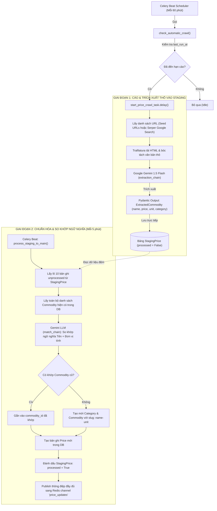

# 📘 COMMODITYLIVE (GOODS PRICE MANAGEMENT) - TECHNICAL HANDOVER GUIDE

> **Tài liệu bàn giao kỹ thuật kiến trúc & nghiệp vụ cốt lõi dành cho Kỹ sư phần mềm và AI Agent.**  
> *Được biên soạn bởi Principal Architect dựa trên phân tích chi tiết toàn bộ mã nguồn thực tế.*

---

## 📑 MỤC LỤC
1. [Tổng Quan Nghiệp Vụ & Đối Tượng Sử Dụng](#1-tổng-quan-nghiệp-vụ--đối-tượng-sử-dụng)
2. [Sơ Đồ Tương Tác Toàn Hệ Thống](#2-sơ-đồ-tương-tác-toàn-hệ-thống)
3. [Chi Tiết Mô Hình Dữ Liệu (PostgreSQL Schema `goods_db`)](#3-chi-tiết-mô-hình-dữ-liệu-postgresql-schema-goods_db)
4. [Chi Tiết 2 Luồng Nghiệp Vụ Cốt Lõi](#4-chi-tiết-2-luồng-nghiệp-vụ-cốt-lõi)
   - [4.1. Luồng Cào Dữ Liệu & Trích Xuất Giá Tự Động Bằng LLM](#41-luồng-cào-dữ-liệu--trích-xuất-giá-tự-động-bằng-llm)
   - [4.2. Luồng Phân Phối Dữ Liệu Realtime Qua WebSocket & Cache](#42-luồng-phân-phối-dữ-liệu-realtime-qua-websocket--cache)
5. [Các Quy Tắc Bất Di Bất Dịch & Điểm Rủi Ro (Caveats & Pitfalls)](#5-các-quy-tắc-bất-di-bất-dịch--điểm-rủi-ro-caveats--pitfalls)
6. [Cheatsheet Lệnh Vận Hành: Dev / Test / Celery / Deploy](#6-cheatsheet-lệnh-vận-hành-dev--test--celery--deploy)

---

## 1. TỔNG QUAN NGHIỆP VỤ & ĐỐI TƯỢNG SỬ DỤNG

### 1.1. Bài toán giải quyết
Hệ thống **CommodityLive** giải quyết bài toán theo dõi, lưu trữ lịch sử và cập nhật biến động giá của các mặt hàng tiêu dùng, nông sản, thủy hải sản, vật liệu xây dựng... tại thị trường Việt Nam theo thời gian thực. Hệ thống hỗ trợ đa vùng miền (`Region`), kết hợp hài hòa giữa **nhập liệu thủ công chuẩn hóa** và **tự động hóa trích xuất từ Internet bằng AI (Google Gemini + Serper Search)**.

### 1.2. Các vai trò người dùng (User Roles)
Hệ thống định nghĩa phân quyền dựa trên enum [`UserRole`](file:///e:/personal/goods_price_management/backend/app/models/base.py#L11-L13):

1. **Khách vãng lai (`Public / Anonymous`)**:
   - Truy cập giao diện Next.js PWA (Mobile-first, tối ưu tải trang cực nhanh nhờ cơ chế ISR và Redis Cache).
   - Xem danh sách hàng hóa, lọc theo danh mục (`category`), tìm kiếm từ khóa.
   - Nhận tín hiệu biến động giá trực tiếp theo thời gian thực qua kênh WebSocket mà không cần reload trang.
2. **Nhân viên nhập liệu (`DATA_ENTRY`)**:
   - Đăng nhập bảo mật JWT qua `/api/auth/login`. Bắt buộc đổi mật khẩu ở lần đăng nhập đầu tiên nếu cờ `must_change_password=True`.
   - **Phân quyền theo ngành hàng**: Chỉ được phép xem danh sách và cập nhật giá cho các mặt hàng nằm trong danh mục mà nhân viên đó được cấp quyền (`permitted_categories`).
   - Cập nhật giá hàng ngày tại endpoint `/api/data-entry/prices`.
3. **Quản trị viên (`ADMIN`)**:
   - Toàn quyền quản trị hệ thống: Tạo tài khoản nhân viên, gán danh mục quyền hạn (`/api/admin/users/{user_id}/permissions`).
   - Quản lý danh mục (`Category`) và hàng hóa (`Commodity`).
   - Cấu hình bot cào dữ liệu (`AutoCrawlerConfig`), kích hoạt cào giá thủ công (`/api/admin/crawler/run`).

---

## 2. SƠ ĐỒ TƯƠNG TÁC TOÀN HỆ THỐNG

Kiến trúc phân tán được đóng gói độc lập trong [docker-compose.yml](file:///e:/personal/goods_price_management/docker-compose.yml):

```
+---------------------------------------------------------------------------------------------------+
|                                          CLIENT LAYER                                             |
|   +---------------------------------------+       +-------------------------------------------+   |
|   |   Public Users (Mobile PWA Browser)   |       |    Data Entry / Admin (Desktop Dashboard)  |   |
|   +-------------------+-------------------+       +---------------------+---------------------+   |
+-----------------------|-------------------------------------------------|-------------------------+
                        |                                                 |                          
                        v                                                 v                          
+---------------------------------------------------------------------------------------------------+
|   FRONTEND: Next.js 14 (App Router, TailwindCSS, Recharts, ISR Cache) [Port 3007 : 3000]         |
+-----------------------+-------------------------------------------------+-------------------------+
                        | HTTP (REST API)                                 | WebSocket (/ws/prices)   
                        v                                                 v                          
+---------------------------------------------------------------------------------------------------+
|   BACKEND API: FastAPI + Uvicorn (Lifespan, ConnectionManager) [Port 8002 : 8000]                 |
|   - File: backend/app/main.py                                                                     |
+-------------------+------------------------------+------------------------------+-----------------+
                    |                              |                              |                  
       SQLAlchemy   | Read/Write                   | Pub/Sub & Cache              | Trigger Task     
       (AsyncPG)    v                              v                              v                  
+----------------------------+   +----------------------------------+   +---------------------------+
|  DATABASE: PostgreSQL 15   |   |   CACHE & BROKER: Redis 7        |   | SCHEDULER: Celery Beat    |
|  - Port 5432               |   |   - Port 6379                    |   | - File: app/tasks/worker  |
|  - Schema: goods_db        |   |   - Channel: "price_updates"     |   | - 1h crawl, 5m staging    |
|  - Tables: commodities,    |   |   - Key: "price:latest:{id}"     |   +-------------+-------------+
|    prices, users, staging  |   +-----------------+----------------+                 |              
+----------------------------+                     ^                                  | Dispatches   
              ^                                    | Task Queue                       v              
              |                                    +----------------------+-------------------------+
              |                                                           |                          
              | Writes Staging & Commits Main                             v                          
+-------------+-------------------------------------------------------------------------------------+
|   BACKGROUND WORKER: Celery Worker (Pool Solo, Asyncio EventLoop) [Container: goods_worker]       |
|   - File: backend/app/tasks/worker.py                                                             |
|   - Trafilatura (HTML Parser)                                                                     |
|   - Serper API (Google Search Service)                                                            |
|   - LangChain Google GenAI (ChatGoogleGenerativeAI - Gemini 1.5 Flash)                            |
+---------------------------------------------------------------------------------------------------+
```

---

## 3. CHI TIẾT MÔ HÌNH DỮ LIỆU (PostgreSQL Schema `goods_db`)

Tất cả bảng đều nằm trong PostgreSQL Schema `goods_db`, được khai báo trong [`backend/app/models/base.py`](file:///e:/personal/goods_price_management/backend/app/models/base.py):

| Tên Bảng | Thực Thể & Mô Tả | Các Cột Quan Trọng | Quan Hệ (Relationships) |
| :--- | :--- | :--- | :--- |
| **`users`** | Tài khoản nhân viên & quản trị viên | `id` (UUID), `username`, `hashed_password`, `role` (ADMIN/DATA_ENTRY), `must_change_password`, `is_active` | N-N với `categories` thông qua bảng `user_category_permissions` |
| **`categories`** | Nhóm/Ngành hàng (Nông sản, Vật liệu, v.v.) | `id` (UUID), `name` (unique), `slug` (unique) | 1-N với `commodities`, N-N với `users` |
| **`user_category_permissions`** | Bảng liên kết phân quyền ngành hàng | `user_id` (FK `users.id`), `category_id` (FK `categories.id`) | Khóa ngoại kép, OnDelete: CASCADE |
| **`commodities`** | Mặt hàng cụ thể gắn với đơn vị tính | `id` (UUID), `category_id` (FK), `name`, `slug` (unique index), `unit` (kg, tấn, bao 50kg), `description` | N-1 với `categories`, 1-N với `prices`. Property: `latest_price` |
| **`regions`** | Thị trường / Vùng miền áp dụng giá | `id` (UUID), `name` ("Việt Nam"), `code` ("VN", unique) | 1-N với `prices` |
| **`prices`** | Lịch sử biến động giá (Time-series) | `id` (UUID), `commodity_id` (FK), `region_id` (FK), `price` (Numeric 18,4), `source_url`, `timestamp` (Indexed) | N-1 với `commodities`, N-1 với `regions` |
| **`staging_prices`** | Vùng đệm chứa giá cào thô từ AI | `id` (UUID), `name`, `price`, `unit`, `category_name`, `source_url`, `created_at`, `processed` (Boolean) | Hàng đợi độc lập, xử lý định kỳ trước khi nhập vào `commodities` và `prices` |
| **`auto_crawler_configs`**| Cấu hình tham số bot cào AI | `id`, `search_keywords` (JSONB), `seed_urls` (JSONB), `scraping_interval_minutes` (default 60), `last_run_at`, `is_active` | Bảng cấu hình hệ thống (Singleton 1 record) |
| **`search_cache`** | Cache đường dẫn tìm kiếm từ Google | `id`, `keyword` (unique index), `urls` (JSONB), `created_at` | Giảm thiểu số lần gọi sang Serper API |

---

## 4. CHI TIẾT 2 LUỒNG NGHIỆP VỤ CỐT LÕI

### 4.1. Luồng Cào Dữ Liệu & Trích Xuất Giá Tự Động Bằng LLM
Được định nghĩa tại [`backend/app/tasks/worker.py`](file:///e:/personal/goods_price_management/backend/app/tasks/worker.py):



### 4.2. Luồng Phân Phối Dữ Liệu Realtime Qua WebSocket & Cache
Cơ chế đảm bảo dữ liệu hiển thị tức thời tới người dùng mà không gây tải cho PostgreSQL:

1. **Khởi tạo kết nối**:
   - Khi Backend khởi chạy ([`backend/app/main.py`](file:///e:/personal/goods_price_management/backend/app/main.py#L42-L55)), hàm `lifespan` kích hoạt một background task bất đồng bộ chạy `redis_listener()`.
   - `redis_listener()` đăng ký lắng nghe (Subscribe) kênh Pub/Sub mang tên `"price_updates"`.
2. **Quản lý kết nối Client**:
   - Client Frontend mở kết nối WebSocket tới endpoint `ws://<host>:8002/ws/prices`.
   - Lớp `ConnectionManager` chấp thuận và lưu kết nối vào danh sách `self.active_connections`.
3. **Kích hoạt phát thanh (Broadcast Event)**:
   - Khi có giá mới (từ cập nhật thủ công `/api/data-entry/prices` hoặc từ Celery Staging Worker):
   - Backend hoặc Worker thực hiện:
     ```python
     await redis_client.set(f"price:latest:{commodity_id}", json.dumps(payload))
     await redis_client.publish("price_updates", json.dumps(payload))
     ```
   - `redis_listener()` bắt được thông điệp từ Redis và gọi `manager.broadcast(data)`, đẩy JSON trực tiếp tới từng socket của người dùng.
4. **Cấu trúc JSON Payload bắn qua WebSocket**:
   ```json
   {
     "commodity_id": "8b51d3b4-...",
     "name": "Lúa OM 5451",
     "slug": "lua-om-5451-kg",
     "unit": "kg",
     "price": 8500.0,
     "timestamp": "2026-10-14T14:30:00Z",
     "category": { "id": "...", "name": "Nông sản", "slug": "nong-san" },
     "region": { "id": "...", "name": "Việt Nam", "code": "VN" }
   }
   ```

---

## 5. CÁC QUY TẮC BẤT DI BẤT DỊCH & ĐIỂM RỦI RO (CAVEATS & PITFALLS)

### ⚠️ QUY TẮC NGHIỆP VỤ BẮT BUỘC (CONSTRAINTS)

1. **Định danh duy nhất của hàng hóa (`Identity = Name + Unit`)**:
   - Tuyệt đối không được gộp các mặt hàng chỉ dựa trên tên. Ví dụ: *Xi măng (bao 50kg)* và *Xi măng (tấn)* là 2 mặt hàng khác biệt.
   - Slug sinh ra bắt buộc phải theo chuẩn: `full_slug = f"{name_slug}-{unit_slug}"`.
   - Trong prompt Gemini so khớp cũng bắt buộc ràng buộc: *Chỉ khớp khi cùng tên (hoặc tương đương) VÀ CÙNG ĐƠN VỊ TÍNH*.
2. **Quy tắc gộp giá trong ngày (`Daily Price Deduplication / Aggregation`)**:
   - Khi nhập liệu qua API `/api/data-entry/prices`, hệ thống kiểm tra: `Price.timestamp >= today_start`.
   - Nếu trong ngày hôm nay đã tồn tại giá của mặt hàng đó tại vùng quy định: **Bắt buộc UPDATE bản ghi cũ**, không được INSERT bản ghi mới để giữ biểu đồ nến/ngày không bị nhiễu.
3. **Kiểm soát phân quyền danh mục (`Category-level RBAC`)**:
   - Tài khoản có vai trò `UserRole.DATA_ENTRY` bắt buộc phải kiểm tra `user.permitted_categories`. Nếu người dùng cập nhật mặt hàng ngoài danh mục được gán, API ném mã lỗi `403 Forbidden`.
4. **Nguyên tắc "Phễu Staging" cho AI**:
   - AI cào dữ liệu từ internet tuyệt đối không được ghi thẳng vào bảng `Commodity` hay `Price`. Phải đi qua `StagingPrice` để giảm tải, tránh spam duplicate và tránh bị cạn hạn mức (Rate-limit) của LLM.

---

### 🚨 CÁC ĐIỂM RỦI RO KỸ THUẬT CẦN CẨN TRỌNG (PITFALLS)

1. **PostgreSQL Schema `goods_db`**:
   - Mọi bảng trong SQLAlchemy model đều có cấu hình `schema="goods_db"`. Khi viết câu lệnh SQL thô (raw query), migration Alembic, hoặc cấu hình DBeaver, bắt buộc phải chỉ định `goods_db.<table_name>` hoặc `SET search_path TO goods_db, public;`.
2. **Async Event Loop trong Celery Worker trên Windows**:
   - Môi trường Windows có xung đột mặc định giữa Celery và Asyncio. Mã nguồn trong [`worker.py`](file:///e:/personal/goods_price_management/backend/app/tasks/worker.py#L116-L132) sử dụng `WindowsSelectorEventLoopPolicy` và hàm wrapper `run_async_task()`.
   - Khi chạy Celery trên Windows, **bắt buộc** phải có cờ `-P solo` (ví dụ: `celery ... -P solo`). Nếu dùng `prefork`, Celery trên Windows sẽ bị crash hoặc treo task.
3. **Cấu hình Supabase Connection Pooling & SSL**:
   - File [`backend/app/init_db.py`](file:///e:/personal/goods_price_management/backend/app/init_db.py#L9-L33) chứa logic tự động xử lý chuỗi kết nối Supabase: tách `sslmode` và inject SSL context tự tạo, đồng thời chuyển qua `NullPool` nếu cờ `USE_SUPABASE_POOLER=True`. Tránh sửa đổi phần cấu hình engine này nếu chưa kiểm tra tương thích với Transaction Pooler (cổng 6543) của Supabase.
4. **Lỗi `MissingGreenlet` do Lazy Loading trong Async SQLAlchemy**:
   - Khi trả về Pydantic response có chứa quan hệ lồng nhau (nested relationships như `User.permitted_categories` hoặc `Commodity.category`), **bắt buộc** dùng `selectinload` (ví dụ: `.options(selectinload(Commodity.category))`). Nếu truy cập thuộc tính quan hệ lười (lazy load) ngoài context async, ứng dụng sẽ quăng ngoại lệ `MissingGreenlet`.

---

## 6. CHEATSHEET LỆNH VẬN HÀNH: DEV / TEST / CELERY / DEPLOY

### 6.1. Môi trường Docker (Toàn bộ hệ thống)
```bash
# Khởi động toàn bộ 6 dịch vụ (API, Worker, Beat, Frontend, Postgres, Redis)
docker-compose up -d --build

# Xem log thời gian thực của từng dịch vụ cụ thể
docker-compose logs -f api
docker-compose logs -f worker
docker-compose logs -f beat

# Dừng và xóa containers
docker-compose down
```

### 6.2. Môi trường Local Development (Chạy trực tiếp)

#### A. Backend (FastAPI)
```bash
cd backend

# Cài đặt môi trường bằng uv (cực nhanh và chuẩn xác)
uv sync

# Khởi chạy database init (tạo schema goods_db và user admin/admin)
uv run python app/init_db.py

# Khởi chạy API Server với Hot-reload
uv run uvicorn app.main:app --reload --port 8000
```

#### B. Celery Worker & Beat (Background Tasks)
* **Trên Windows (Bắt buộc dùng cờ `-P solo`)**:
  ```powershell
  # Terminal 1: Chạy Celery Worker
  uv run celery -A app.tasks.worker worker --loglevel=info -P solo --concurrency=2

  # Terminal 2: Chạy Celery Beat Scheduler
  uv run celery -A app.tasks.worker beat --loglevel=info
  ```
* **Trên Linux / Docker**:
  ```bash
  uv run celery -A app.tasks.worker worker --loglevel=info -P solo
  uv run celery -A app.tasks.worker beat --loglevel=info
  ```

#### C. Frontend (Next.js)
```bash
cd frontend

# Cài đặt thư viện
npm install

# Khởi chạy Next.js ở chế độ development (Port 3000)
npm run dev
```

### 6.3. API Testing & Kích hoạt tác vụ
* **Tài khoản Admin mặc định**:
  - Username: `admin` | Mật khẩu: `admin` (Sau khi login yêu cầu đổi pass nếu muốn).
* **API Swagger Documentation**:
  - Truy cập: `http://localhost:8002/docs` hoặc `http://localhost:8000/docs`.
* **Kích hoạt cào giá AI thủ công**:
  ```bash
  curl -X POST "http://localhost:8002/api/admin/crawler/run" \
       -H "Authorization: Bearer <ADMIN_JWT_TOKEN>"
  ```
* **Kiểm tra WebSocket Stream**:
  - Dùng Postman hoặc Web browser kết nối tới: `ws://localhost:8002/ws/prices`.

### 6.4. Deployment Commands
* **Triển khai Backend lên Hugging Face Spaces (sử dụng git subtree)**:
  ```bash
  # Tách nhánh deploy từ thư mục backend
  git subtree split --prefix backend -b deploy

  # Đẩy lên HF Spaces
  git remote add hf https://huggingface.co/spaces/nult2003/goods-price-api
  git push hf deploy:main --force

  # Dọn dẹp nhánh tạm
  git branch -D deploy
  ```
* **Build và Push Docker Image lên Azure ACR**:
  ```bash
  az acr login --name acrgoodsmanagementtest
  docker build -t acrgoodsmanagementtest.azurecr.io/goods-backend:v1 ./backend
  docker push acrgoodsmanagementtest.azurecr.io/goods-backend:v1
  ```

---
*Tài liệu này được xác thực và đồng bộ hoàn toàn với codebase tại commit hiện tại.*

